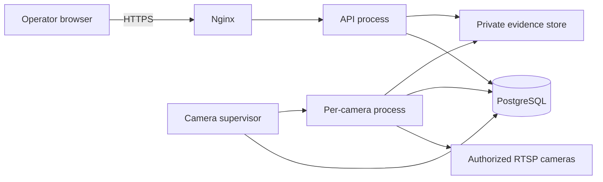

# Architecture

**Status:** Recommended design, draft 0.1, 27 October 2026. Not implemented. Not an approved baseline until OD-001 is accepted.

This document describes a modular monolith with separate worker processes. It is the proposed shape for a product that must be installed at a customer site and must also be able to host more than one organization later. It is not a microservice platform.

## What was rejected as the starting point

| Alternative | Why it was not chosen for the first build |
| --- | --- |
| Microservices for API, detection, rules, and events | More deployment failure modes for an on-prem installer, no team-size evidence that separate services are needed, and no existing system to decompose. |
| All processing inside HTTP request handlers | A stuck camera would block the dashboard. Ingestion has to be independent of API latency. |
| Cloud ingest of RTSP as the default | Camera networks are usually isolated. Sending every stream across the public internet increases bandwidth, outage, and exposure. Remote viewing of events can come later without moving the streams. |
| Browser connecting to cameras | Would give camera passwords and network paths to every operator device. |
| Celery plus current Redis as a default dependency | Live cameras are long-running streams, not short jobs. Redis distributions after the 7.2 BSD line use a different license. An extra broker is another service to back up. |
| Ultralytics YOLO as an automatic dependency | The Ultralytics code license is AGPL-3.0. That may be incompatible with a closed-source commercial product unless a separate commercial license is purchased and recorded. See OD-004. |
| A new model or tracker inside the API process with no adapter | The detection model must be replaceable without rewriting rules or events. |

The earlier Word SRS selected OpenCV and YOLO in its operating-environment section. Those are treated as unreviewed candidates, not as decisions.

## Recommended stack

| Concern | Recommendation | Also considered | Reason |
| --- | --- | --- | --- |
| API | Python 3.12 and FastAPI | Django, Go, .NET | Python is the practical language for the inference work. FastAPI gives typed HTTP and OpenAPI. Django's admin is not a substitute for tenant-safe authorization. Go would be strong for networking and weaker for the model loop. .NET was not required by a Windows-only decision. |
| Data access | SQLAlchemy 2 and Alembic | Raw SQL only | Migrations are a release requirement. SQL still has to be written so tenant predicates cannot be forgotten. |
| Database | PostgreSQL 16 | MySQL, SQLite | Constraints, row-level security, and `SKIP LOCKED` job claims. SQLite is not a multi-user pilot database. |
| Web UI | React, TypeScript, Vite | Next.js, Vue | The UI is a signed-in dashboard. Server-side rendering does not solve camera processing. Vite is enough. |
| Camera decode | PyAV against an LGPL FFmpeg build | OpenCV `VideoCapture`, GStreamer, MediaMTX as the product itself | Timeouts and packet behavior need to be visible. OpenCV hides them. GStreamer is capable and costly to package. MediaMTX is a good **test fixture** and a possible later relay, not the core product. |
| Inference runtime | ONNX Runtime, CPU first | Ultralytics runtime, TensorRT, OpenVINO | MIT-licensed runtime. Weights are a separate license. GPU execution providers can be added after a measured CPU baseline fails. |
| Tracking | A small IoU tracker owned by this product | ByteTrack or similar, after license review | Release 1 needs a track that is stable enough to know "entered" from "still inside". A small tracker keeps the license surface small. Replace it if evaluation shows ID switches dominate errors. |
| Short jobs | PostgreSQL table with `SKIP LOCKED` | Celery, RQ, Valkey | Retention, reconciliation, and future notification retries are low volume. |
| Live camera execution | One supervisor process and one child process per camera | Threads only | Native decode libraries can fault. A dead child must not take every camera with it. |
| Reverse proxy and TLS | Nginx | Caddy, Traefik | Familiar to the people who will sit next to an NVR. Automatic certificate tooling can be added when a host is intentionally published. |
| Evidence | A storage interface with a private directory backend | Direct writes from the API, public object buckets | Hosted pilots can add an S3-compatible backend later without changing events. |
| Web tests | Vitest and Playwright | Cypress | Component tests plus a few browser journeys. |
| API tests | pytest and HTTPX | Unittest only | Integration tests need a real PostgreSQL. |
| Containers | Docker Compose | Kubernetes | Kubernetes is an enterprise option after more than one node is a real requirement. |

Versions get pinned in Milestone 0. They are not pinned yet because no project files exist.

## System context



The browser never opens RTSP. The API never needs to be the process that decodes video. Camera child processes do not serve user traffic.

## Process model

Three long-running parts are enough for the pilot:

1. **Proxy.** Terminates TLS when TLS is enabled, serves the static UI, forwards `/api/` to the API, and applies request-size limits.
2. **API.** Authentication, authorization, validation, configuration, event queries, evidence authorization, audit writes, and health.
3. **Worker supervisor.** Holds leases for cameras that this host should run, starts and restarts child processes, runs the short-job loop, and reports its own heartbeat.

Each **camera child**:

- Connects only to its assigned RTSP URL.
- Decodes and samples frames under configured limits.
- Calls the detection adapter and the tracker.
- Evaluates the active rule versions.
- Inserts events and writes snapshots.
- Updates that camera's health row.
- Exits when the parent stops it, when the camera is disabled, or when its lease is lost.

A queue of frames inside a child is bounded, proposed depth 1 or 2. If inference is slower than the sample rate, the child drops the oldest unprocessed frame, increments a dropped-frame counter, and continues. It does not build an unbounded backlog.

Parent restart policy: if a child exits, restart that camera only, with exponential backoff capped and jittered. Repeated failure leaves the camera in `Error` or `Reconnecting` with the last error string safe for an operator. Other children keep running.

## Modules inside the monolith

One Python package, several modules, two entry points (`api` and `worker`). Suggested layout when implementation starts:

```text
backend/src/cctv_platform/
  api/                HTTP routers and dependencies
  settings.py         environment configuration only
  db/                 engine, migrations, tenant context
  modules/
    identity/         users, sessions, passwords, MFA hooks
    tenancy/          organizations, sites, memberships, support grants
    audit/
    cameras/
    zones/            zones and versioned rules
    events/
    evidence/
    licensing/        entitlement checks
    inference/        PersonDetector adapter
    tracking/
    rules/            pure geometry and transition logic
  workers/
    supervisor.py
    camera_process.py
    jobs.py
frontend/
deploy/
```

Rule geometry must be testable without a camera or a model. Inference must be testable with a fake detector that returns fixed boxes.

### Adapter contracts

These contracts are part of the architecture so later models, storage, and identity providers do not rewrite events.

**Person detector.** Input is an image plus a configuration record. Output is zero or more person boxes with a confidence and the model version string. No identity, face landmark, age, or emotion field is part of the contract. Release 1 implementations must refuse to return those attributes even if a weight file could produce them.

**Tracker.** Input is the current detections and the previous track state. Output is tracks with stable IDs for this camera process only. Track IDs are not people and must not be reused as a cross-camera identity.

**Evidence store.** `put`, `get`, and `delete` by an opaque key. Callers pass organization and evidence identifiers. The filesystem backend roots all paths in a configured directory and rejects path traversal. A later object-storage backend must scope keys by organization prefix.

**Entitlement service.** Answers whether an organization may enable another camera and whether a feature flag is on. Release 1 reads a local row. Release 1.1 may add a signed license file behind the same function.

**Notifier.** Release 1 has a no-op implementation. Event creation does not call a provider.

**Identity provider.** Release 1 is local accounts. The session layer is the only part later mobile tokens or enterprise SSO should replace. Authorization stays in one module.

## Tenancy and request path

Every customer-owned row carries `organization_id`. Cameras, zones, and events also carry `site_id`.

Recommended request shape:

```text
/api/v1/orgs/{organization_id}/sites/{site_id}/cameras
/api/v1/orgs/{organization_id}/events
/api/v1/orgs/{organization_id}/events/{event_id}
```

The server loads the session, loads the membership, and checks that the path organization is one the user may access. It then sets a transaction-local organization id and queries through repositories that require that id. Fetching "by event id" without an organization predicate is a defect.

Platform routes, if hosted mode is on, live under `/api/v1/platform/` and require a platform role. They do not reuse customer handlers with a hidden bypass.

Partner access, when built, is a row granting a partner user a permission set on one customer organization for a time window. It is not a second login that shares the customer's password.

PostgreSQL row-level security is recommended on tenant tables as a backstop (OD-014). The application still applies its own predicates. RLS is not an excuse for unscoped queries in code, because a mis-set session variable must fail closed. The database role used by the API must not be a superuser and must not own the tables in a way that bypasses RLS.

### Deployment modes and isolation

| Deployment | Organizations in the database | Isolation bar |
| --- | --- | --- |
| Customer-hosted, one customer | One | Same code path. Tests still include a second organization. |
| Installer server with several customers | Many | Full tenant tests are a launch gate. |
| Vendor-hosted | Many | Full tenant tests, plus no standing vendor access to evidence. |

There is one code path. A "single tenant build" that deletes the organization column would create a second product.

### Roles

| Role | Held by | Release |
| --- | --- | --- |
| Customer administrator | Customer staff who manage users, cameras, zones, and retention within policy | R1 |
| Security operator | People who watch health and review events | R1 |
| Auditor | Read-only review of events, permitted evidence, and audit | R1 |
| Platform administrator | Vendor staff on a hosted system | R1 control exists; no evidence access by default |
| Partner user | Installer staff | R1.1 delegation |
| Worker | Database role, not a browser user | R1 |

Host SSH and Docker administration are outside application roles. An operator account must not be the server root login.

Permission checks sit in the API layer for every operation, including evidence bytes. Hiding a button is not a control.

## Data model

Names are logical. They are not a migration.

**Organization.** Id, name, status.

**Site.** Id, organization, name, timezone for display.

**User.** Id, email, password hash, disabled flag. Users are global identities. Access is only through membership.

**Membership.** User, organization, role.

**Support grant.** Organization, grantee, permission set, start, end, reason, created by. Empty in a normal on-prem install.

**Camera.** Id, organization, site, display name, enabled, host, port, path, transport, username, sampling and limit settings, status, last frame time, last error code, processing delay, configuration version. Password is not in this row.

**Camera secret.** Camera id, encrypted password, key version. Separate so list queries do not touch secrets.

**Zone and rule version.** Append-only versions. Geometry in normalized coordinates, reference point definition, minimum confidence, persistence, cooldown, tracking-loss behavior, enabled flag, author, time. Events store the rule version id that fired.

**Event.** Id, organization, site, camera, zone, rule version, type, state, track id local to the process, confidence, model version, inference configuration id, server frame time, commit time, evidence status.

**Event transition.** From state, to state, actor, note, time. The current state also lives on the event for queries.

**Evidence object.** Id, organization, event, kind, storage key, media type, byte size, checksum, created time, expires time, capture status.

**Audit event.** Time, actor, organization, action, object type, object id, outcome, request id. No secrets and no image bytes.

**Entitlement.** Organization, max enabled cameras, feature flags, status, valid until.

**Job.** Type, payload, run after, attempts, locked by, locked until.

**Detector profile.** Model name, version, checksum, runtime, threshold defaults. Events point at the profile that actually ran.

Deletion of a camera disables processing immediately. Historical events remain until retention or an explicit purge, so investigations are not wiped by a configuration edit. Purge is a separate audited operation.

## Main data flows

### Configure a camera

1. Customer administrator submits a display name, RTSP fields, and password over an authenticated request.
2. API checks membership, entitlement, URL scheme, and that the resolved address is in an allowed network range.
3. API stores connection fields and the encrypted password, writes an audit row, and does not return the password.
4. Supervisor observes the enabled camera, takes a lease, and starts a child.

Allowed schemes for Release 1 are `rtsp` and `rtsps`. `file`, `http`, `https`, and `ftp` are rejected. Resolving a hostname and then connecting to a different address is a defect. Block link-local, loopback, and cloud metadata addresses except an explicit test flag that cannot be enabled by a customer administrator in a hosted deployment.

### Detect an entry

1. Child reads frames and keeps a sampled subset according to configuration.
2. Detector returns person boxes. Tracker updates tracks.
3. Rule module compares each track's reference point with the active polygon. The proposed reference point is the bottom center of the box, which approximates feet on a typical wall-mounted camera and is wrong for many overhead cameras. The zone editor must state that limitation.
4. A track moves from outside to inside and stays inside for the configured persistence. The rule emits one entry or inward crossing.
5. The child inserts the event in the database first, with evidence status `pending`.
6. The child writes a snapshot. On success it attaches the evidence row. On failure it marks evidence `failed` and stores a safe reason. The event remains.
7. Cooldown and "already inside" state suppress repeats. That state should survive long enough that a child restart within the cooldown does not immediately alert again. Persist the last emit time per camera and zone, not only in memory. Track ids die with the process; zone cooldown is what covers restart.

Tracking loss: if points are missing beyond the configured gap, the track ends. The next detection in the zone is a new track. Whether that new track alerts depends on cooldown and on a rule flag for "alert on reacquisition". Proposed default is to treat reacquisition inside the zone as continued presence, not as a new entry, until the person has been observed outside or the cooldown has passed. This will miss a second person who appears while the first track is lost. That limitation is accepted for Release 1 and must be visible to the administrator.

### Review an event

Operator lists events with filters and pagination. Detail shows metadata and, if evidence exists and the role allows it, the image fetched through the API. The API checks organization, role, and retention before reading bytes. Acknowledgement, resolution, and false-alert transitions are audited. They do not mean the activity was a crime.

### Retention

A job selects evidence past its expiry, deletes the object, then marks the row deleted. A second job finds storage keys that no longer have rows, and rows whose bytes are already gone. Metadata retention is a separate, usually longer, period. Audit retention is independent. Backups are copies and must be included in the deletion story in the runbook, or they silently extend retention.

## Camera health

| State | Meaning |
| --- | --- |
| Disabled | Administrator turned it off. No reconnect. |
| Connecting | Child is attempting the first connection. |
| Online | Frames are being received and sampled within the configured freshness window. |
| Reconnecting | Stream lost. Backoff in progress. |
| Degraded | Connected but frames are late, drops exceed a threshold, or inference is behind. |
| Error | Configuration rejected, authentication failed, or retry budget exhausted. |

`Online` requires fresh frames, not merely a TCP connection. If inference stops, the state cannot stay `Online`. The dashboard must show last-frame time and processing delay.

Proposed freshness and backoff numbers are implementation defaults to tune in tests, not SLAs: mark degraded when the last decoded frame is older than twice the sample interval or older than five seconds, whichever is greater; backoff from one second to a cap of sixty seconds with jitter; reset the backoff after a stable period.

## Security boundaries

Trust boundaries are specified in [threat-model.md](threat-model.md). Architecturally:

- The proxy is the only process with a published port.
- PostgreSQL and evidence files are on a private network or a private volume.
- Worker database credentials can insert events and update health. They cannot alter memberships.
- API database credentials can serve the application and cannot disable row-level security.
- Encryption keys for camera passwords come from the environment or a file mounted as a secret, not from the database they protect.
- Logs go to stdout as structured JSON. A redaction formatter strips URL userinfo, password fields, and authorization headers.

Session recommendation (OD-015): random session id in an HttpOnly, Secure, SameSite cookie, row stored hashed at rest, idle and absolute expiry, logout deletes the row, CSRF token for cookie-authenticated mutations. Service-to-service HTTP inside the product should be unnecessary in Release 1 because the worker uses the database.

## API compatibility

`/api/v1` is the contract a later mobile client may use. Breaking changes require a new version. Error bodies use a stable code, a human message, and a request id. They do not include stack traces, SQL, or secrets.

Pagination uses a page size with a server-side maximum of 100. Filters for events: time range, site, camera, zone, type, state.

OpenAPI is generated from the API and is not a public unauthenticated document if it reveals internal structure more than the customer needs. At minimum it requires the same network reachability as the API.

## Observability

Structured logs include time, level, service, organization id where known, camera id where known, and request id. They exclude secrets and images.

Health:

- Liveness: process is running.
- Readiness: API can reach the database. Worker readiness includes a fresh supervisor heartbeat.
- Neither endpoint prints configuration or counts that would help an unauthenticated attacker map tenants. A detailed status page is authenticated.

Metrics to expose internally, even if the first dashboard is simple: frames received, sampled, inferred, dropped; inference duration; queue depth; reconnects; event inserts; evidence failures; job lag. Host CPU, memory, and disk are part of the benchmark and the runbook, not necessarily a custom metrics product in Release 1.

## Deployment

Docker Compose on one machine is the Release 1 unit:

- `proxy`
- `api`
- `worker`
- `postgres`
- named volumes for database and evidence

Development may run the UI toolchain on the host. The pilot runs the built static files behind the proxy.

Default bind is a private interface. Publishing to the internet requires TLS, a reviewed firewall, and OD-002. Loopback HTTP is allowed only for local development and must not be the pilot configuration.

Resource limits are set on containers so a decode loop cannot consume the host without bound. Exact numbers come from the first hardware profile.

Configuration is environment variables and mounted files. No tenant id, password, or storage path is compiled in. An example file lists variable names and fake values.

### Upgrades

Image tags are immutable. A migration runs forward before the new API serves traffic. Rollback is the previous image plus a database backup taken immediately before the migration. Down-migrations are not the primary rollback if they can drop evidence metadata. The runbook owns the exact sequence once files exist.

## Future extension points

| Future need | Where it attaches | What Release 1 must not do |
| --- | --- | --- |
| Second detector | `PersonDetector` | Store raw vendor objects on the event |
| GPU | ONNX execution provider setting | Promise a camera count that needs a GPU |
| Clips | Evidence kind on the same store | Block the pilot on clip support |
| Email or another notifier | `Notifier` | Call a provider from the camera child |
| License file | `Entitlement service` | Scatter limit checks across the UI |
| SSO | Identity provider behind the same session | Duplicate role logic in the identity product |
| Training | Separate worker profile, separate data store, model registry | Train on the API process or on production credentials |
| Natural-language search | Read-only query over events the user can already read | Send other tenants' events to a model |
| Edge box | Same worker, local database, sync later | Fork event semantics |
| Native mobile | `/api/v1` | Put business rules only in React |

Training and search are specified as future consumers of the event and evidence model. They are not modules in the pilot process list.

## Scale position

The provisional workload to **test**, not to sell, is five cameras at 720p and 10 frames per second input, with a lower inference sample rate chosen on the hardware. The architecture should be comfortable there by configuration: more camera processes, a lower sample rate, or a faster execution provider. It does not include sharding, multi-region replication, or a message bus.

If a pilot needs more cameras than one worker host can decode, the next step is a second worker host with camera leases, not a rewrite. Leases are the seam. Do not build the second host until a measured bottleneck says so.

## Consistency rules

- Event insert commits before evidence upload is considered complete.
- Rule edits create a new version and do not rewrite old events.
- Clocks are UTC in the database. Display uses the site timezone.
- Ids are opaque. Sequential ids that leak a global count across tenants should be avoided in hosted mode; use UUIDs.
- Configuration changes that affect processing bump a version the child watches so it reloads without a manual restart where that can be done safely. Credential changes must reconnect.

## What this architecture does not prove

No capacity number, threat mitigation, or recovery time in this document has been demonstrated. The implementation plan defines when each piece is built and tested.
